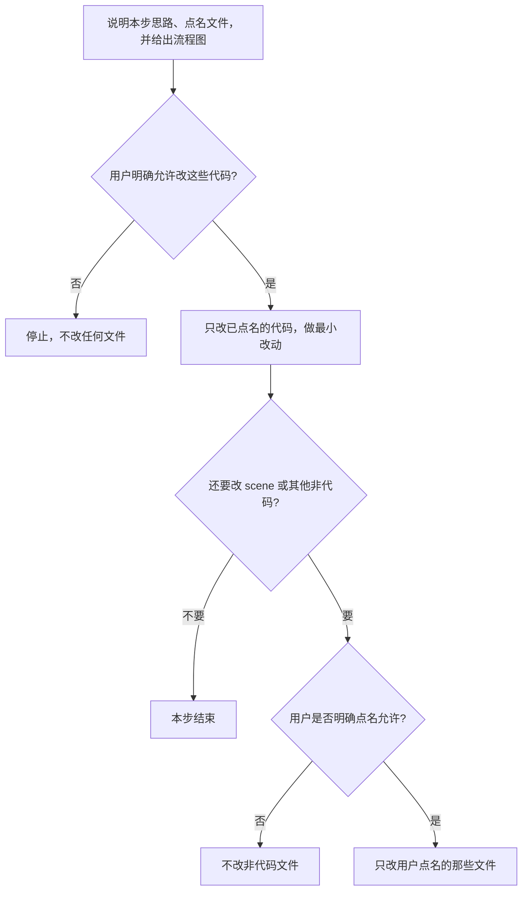
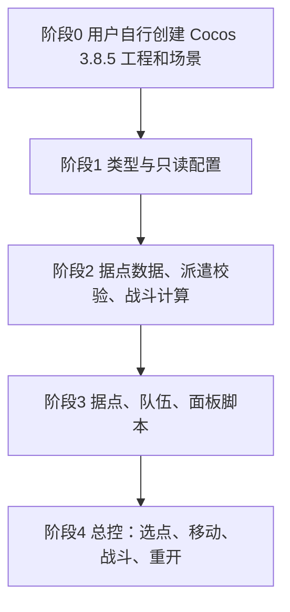

# 据点争夺 Demo 策划与开发纪律

后续开发只以本文件为准。用户自己创建 Cocos 工程；未获明确同意前，不新建工程、不改 scene。

## 开发纪律

每次改动遵守下面的门禁。策划未写的功能不做。



- 改代码前先讲思路：为什么改、改哪些文件、每个文件改什么。附流程图。用户明确允许后才动手。
- 只改已经点名并获准的 TypeScript。最小改动：不重构旁边的代码，不顺手改格式，不加策划外的功能。
- 非代码文件一律不改，除非用户对具体文件明确说可以改。包括 scene、prefab、meta、动画、图片、字体、材质和工程设置。不要自己创建或手改 `.meta`。
- 用户尚未建好工程时，停在说明，不提前加脚本。

开发顺序：



阶段 0 由用户完成。阶段 1 起每步仍要单独征得改代码的同意。脚本先不挂到 scene；挂节点、改 scene 必须用户另行点名同意。

职责分开，不要堆进一个组件：只读配置、类型、据点运行时数据、选点与派遣校验、一跳战斗的纯计算、据点显示、队伍显示、面板、总控。总控负责衔接、计时和重开。视图不直接改阵营或兵力规则。关键类型、字段和方法写明职责。玩家可见文案用下文原句。

## 产品结论

Cocos Creator 3.8.5 + TypeScript，纯 2D、横屏 1280×720 的单机据点争夺。3 个据点。玩家从己方据点派兵，沿固定三点路径走到目标，双方按间隔互扣兵力，守军归零则占领。同时只有一支队伍在移动或战斗。没有敌方 AI，没有资源产出，没有胜负关卡。

斜视角只允许出现在贴图上。逻辑坐标只有 x、y。

## 画面与引擎边界

- 玩法节点全部放在同一个 Canvas 下。设计分辨率 1280×720，适配 SHOW_ALL。原点在 Canvas 中心，x 向右，y 向上。只用 Canvas 本地坐标。
- 玩家不能拖地图或缩放。
- 允许：Canvas、Sprite、Label、Graphics、UITransform、Widget、Button、EditBox、Node、Tween、`schedule`。
- 不使用透视相机、网格、光照、阴影、地形、三维碰撞和刚体。
- 从下到上：背景、路线、三个据点（青石城、金顶关、赤焰堡）、队伍、飘字、操作界面和提示。
- 路线不接收点击。系统字体，不导入外部字体。无音效、无音乐、无存档、无随机。
- 鼠标左键与触摸单击相同。无拖拽、右键和快捷键。输入框只保留数字。

## 布局与常量

背景 `#6FA85A`，铺满屏幕。右侧面板中心 `(464, 0)`，尺寸 320×640，左边缘 x=304。面板底色 `#1B2430`，不透明度 92%。

| ID | 名称 | 阵营 | 初始兵力 | 坐标 | 颜色 |
| --- | --- | --- | --- | --- | --- |
| player_base | 青石城 | 玩家 | 100 | (-420, 60) | `#2F6BFF` |
| neutral_pass | 金顶关 | 中立 | 40 | (-40, -160) | `#E0B000` |
| enemy_fort | 赤焰堡 | 对手 | 80 | (180, 80) | `#E23B3B` |

据点可点区域 160×180。色块 120×100 居中。名称在色块上方 78、字号 24。阵营在上方 52、字号 18，只写「玩家」「对手」「中立」。兵力在下方 72、字号 20，格式 `兵力 100`，无千分位。

路线中间点来回共用，返程只反转顺序：

| 据点对 | 中间点 |
| --- | --- |
| 青石城—金顶关 | (-230, -50) |
| 青石城—赤焰堡 | (-120, 170) |
| 金顶关—赤焰堡 | (70, -40) |

路线为白色、30% 透明、线宽 4，开局画好后不再改。缺中间点是配置错误，不能临时改成直线。

| 项目 | 值 |
| --- | --- |
| 默认派遣量 | `min(20, 来源当前兵力)` |
| 移动速度 | 200 像素/秒 |
| 战斗间隔 | 0.5 秒；到达后再等 0.5 秒才扣第一跳 |
| 每跳扣兵 | 双方各 5；不足 5 时按剩余值扣 |
| 提示停留 | 1.5 秒；新提示替换旧提示 |
| 飘字 | 上移 40 像素，0.4 秒后销毁 |
| 来源圈 | `#2EE0FF`，透明度 255 与 120 循环，单程 0.6 秒 |
| 目标圈 | `#FFE14A`，静止 |

常量只放在只读配置。开局和重开都深拷贝出运行时数据，禁止回写配置。

## 界面文案

面板从上到下：标题「据点争夺」、来源、目标、可派遣兵力、减按钮、输入框、加按钮、派遣、重新开始、状态行。

- 未选显示「未选择」。选中格式固定为 `青石城（玩家）`。
- 可派遣兵力等于来源当前兵力；没有来源时为 0。
- 更换来源时，输入框改为默认派遣量；来源兵力为 0 时填 0。只换目标不改输入框。
- 输入框最长 6 位。非数字立刻删除，允许为空。`00020` 按 20。输入过程中不自动改到兵力上限。
- 减号最小到 1；已是 1 或为空时结果为 1。加号最大到来源兵力；为空时先变成 1。来源兵力为 0 时不改数字，提示「兵力不足」。未选来源就按加减，提示「请先选择己方据点」。
- 派遣按钮始终可点。同一次成功派遣处理完之前，后到的点击直接丢弃，不再扣兵，也不再提示。
- 重新开始颜色 `#3D4F66`，任何阶段都可点，无二次确认。
- 状态行平时为空。行军显示「行军中」，交战显示「交战中」。

空闲和已选来源时，点据点有 0.12 秒缩放到 0.94 再回到 1 的反馈；随后即使要弹错误提示也播放。来源用青色呼吸圈，目标用黄圈。

## 阶段

只有空闲、已选来源、行军、交战。场上同时只能有一支队伍。

空闲和已选来源可以改来源和目标。行军和交战的规则见下一节。重开在任何阶段立刻生效。

## 行军与交战中的点击

这次点击只给出视觉焦点，不改变已经出发的队伍。

- 被点中的据点根节点以中心为锚点，0.12 秒内从缩放 1 变为 1.1，并保持 1.1。
- 色块背后加光晕：颜色与该据点阵营相同，不透明度 180，比色块每边大 16 像素。
- 同时只有最后点击的据点保持 1.1 和光晕。点另一个时，上一个 0.12 秒回到 1 并去掉光晕。
- 不用空闲态的 0.94 点按缩放代替这个效果。青色来源圈和黄色目标圈保持原样。
- 面板上的来源、目标、可派遣兵力仍是这次行军或战斗实际使用的据点。
- 不改队伍的来源、目标、路径和战斗，也不弹出「已有队伍在行动」。
- 只有点击派遣才提示「已有队伍在行动」。
- 战斗结算并清空选择时，或任意阶段重开时，放大和光晕一并取消。

## 选点

仅空闲和已选来源会改变来源或目标：

- 点己方据点：设为来源，清空目标，刷新默认兵力。兵力为 0 也可以选。
- 再点当前来源：取消来源和目标，输入框清空，可派遣兵力显示 0。
- 点另一个己方据点：改来源，清空目标，按新来源重填输入框。
- 没来源就点非己方：提示「只能从己方据点出兵」，不设置目标。
- 已有来源时点非己方：设为目标。再点同一个目标保持不变。
- 同阵营不能当目标。占领后该据点变成己方，之后只能用来切换来源。

## 派遣校验

按顺序，第一条失败就停止，只提示这一条：

1. 正在行军或交战：已有队伍在行动
2. 没选来源：请先选择己方据点
3. 来源不是玩家，或来源兵力小于 1：兵力不足
4. 没选目标：请选择目标据点
5. 目标和来源相同，或阵营相同：目标无效
6. 输入为空、不是整数或小于 1：请输入有效兵力
7. 数量大于来源兵力：兵力不足

通过后，在同一次点击里从来源扣兵，刷新据点数字和可派遣兵力，在来源坐标生成队伍，阶段改为行军。来源和目标的选中显示保留到这支队伍结算完。扣兵不返还。重开是整局回到初始兵力，不是撤回这次派遣。

## 移动

路径三点：来源坐标、中间点、目标坐标。每段 Tween 时长等于该段像素长度除以 200。每段开始时更新朝向：下一点 x 大于或等于当前 x 则朝右，否则朝左。箭头绕平面旋转，0 度指向右。最后一段结束时坐标对齐目标中心，停止移动，进入交战。队伍显示剩余兵力；行军时文字为「行军中」，交战时为「交战中」。

## 战斗与占领

到达时守军已经是 0：不开始计时，立刻占领。阵营改为玩家，守军改为这次剩余的全部攻方兵力，删除队伍，提示「占领成功」。

否则必须显式传入第四个参数，避免第一跳提前：

```ts
this.schedule(this.onBattleTick, 0.5, macro.REPEAT_FOREVER, 0.5)
```

每一跳双方各扣 5，最低到 0。同一帧先改队伍人数和据点兵力，再判定：

- 守军为 0 且攻方大于 0：占领成功。据点改为玩家，兵力改为攻方剩余值，颜色和「玩家」同时更换，名称不变。
- 攻方为 0 且守军大于 0：进攻失败。阵营不变，守军保留剩余值。
- 双方同时为 0：进攻失败。阵营不变，守军为 0。

判定成立后立刻取消计时并删除队伍。飘字写实际扣除值，例如剩 3 点写 `-3`。守军飘字在目标 `(30, 40)`，攻方飘字在 `(-30, 40)`。

结算后清空来源、目标和输入框，阶段回到空闲。若已没有非玩家据点，状态行保持「已控制全部据点」，游戏不锁定。若己方所有据点兵力都是 0 且没有队伍，状态行保持「已无可用兵力」。两条不会同时成立，因为成功占领至少留下攻方剩余兵力。

## 重开与清理

重开立即停止队伍 Tween、选中圈 Tween 和战斗 schedule，删除队伍和飘字，隐藏选中圈，取消 1.1 缩放和光晕，用初始配置恢复三个据点，清空选择、输入框、提示和状态行，阶段回到空闲。进行中的战斗不结算，不会因此占领。

事件在启用时注册，在禁用或销毁时解除。销毁队伍前先停掉它上面的 Tween。不用 `setInterval` 或 `setTimeout`。窗口失焦跟着引擎暂停，恢复后不补扣兵力。

## 结果样例

| 操作 | 结果 |
| --- | --- |
| 派 20 打金顶关（40） | 2 秒后进攻失败，金顶关仍为中立，兵力 20 |
| 派 50 打金顶关（40） | 4 秒后占领，变为玩家，兵力 10 |
| 派 40 打兵力 40 的据点 | 4 秒后双方归零，进攻失败，阵营不变，兵力 0 |
| 再派任意兵力打这个空据点 | 到达后立即占领 |
| 派 100 打赤焰堡（80） | 8 秒后占领，变为玩家，兵力 20 |
| 行军或交战中重开 | 直接回到 100、40、80，本次战斗不算 |
